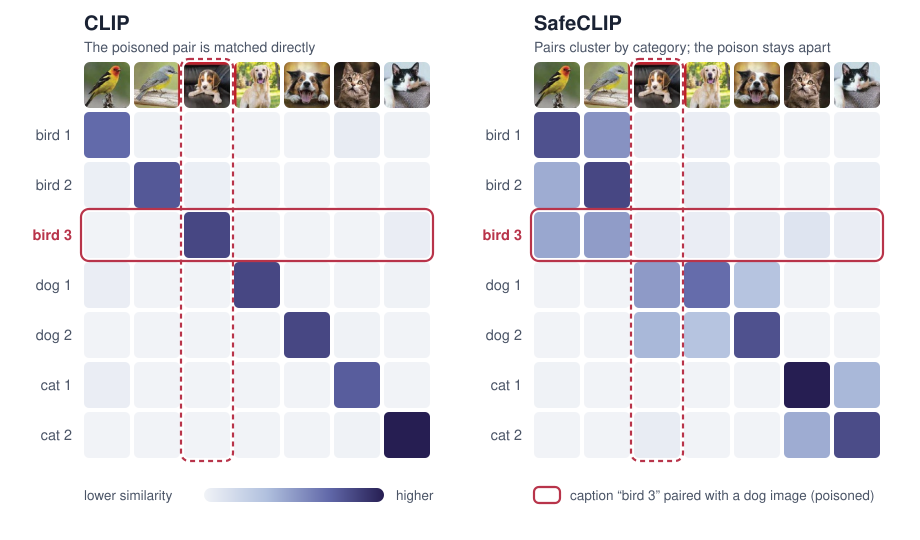
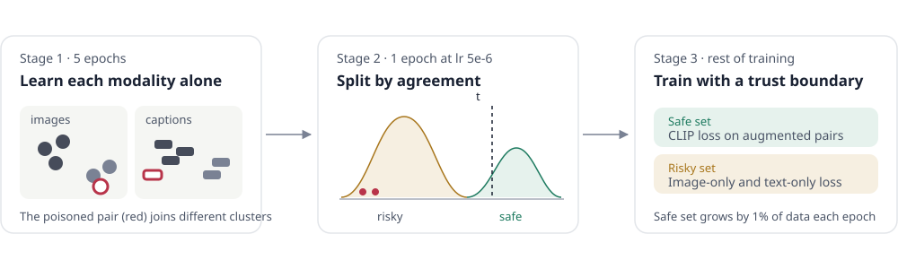

# Better Safe than Sorry: Pre-training CLIP against Targeted Data Poisoning and Backdoor Attacks

**ICML 2024** · [Wenhan Yang](https://hangeryang.github.io/), Jingdong Gao, [Baharan Mirzasoleiman](https://baharanm.github.io/) · UCLA

[Project page](https://hangeryang.github.io/SafeCLIP/) · [Paper](https://arxiv.org/abs/2310.05862) · [PMLR](https://proceedings.mlr.press/v235/yang24i.html) · [Poster](https://icml.cc/virtual/2024/poster/32662)

<p align="center"></p>

<p align="center"></p>

Poisoning about one in a million image–caption pairs is enough to hijack CLIP: it learns to match a dog image to the caption “bird 3” it was poisoned with (above, left). **SafeCLIP** defends during pre-training:

1. **Unimodal warmup.** Train the image and text encoders separately with nearest-neighbor contrastive learning, so a poisoned image clusters with its true category, away from its adversarial caption.
2. **Split by agreement.** Run one CLIP epoch at a very low learning rate, fit a two-component Gaussian mixture to image–caption cosine similarity, and put high-confidence pairs in a *safe* set.
3. **Train with a trust boundary.** Apply the CLIP loss only to the safe set, keep learning from the *risky* set with unimodal losses, and grow the safe set by 1% of the data each epoch.

| | Targeted poisoning (CC3M) | BadNet backdoor (CC3M) | Zero-shot, avg. over 10 datasets |
|---|---|---|---|
| CLIP | 93.75% | 100% | — |
| **SafeCLIP** | **0%** | **0%** | **+0.9** |

It is the first defense that protects CLIP during pre-training without giving up accuracy, and it needs no clean data or clean pre-trained model: it trains from scratch on the poisoned data itself. It also holds against ViT encoders, multi-trigger backdoors, ten times higher poison rates and attacks aimed at its own warmup.

Full results across CC1M, CC3M, MSCOCO and Visual Genome are on the [project page](https://hangeryang.github.io/SafeCLIP/).

## Setup

```bash
git clone https://github.com/HangerYang/SafeCLIP.git
cd SafeCLIP/SafeCLIP
conda env create --prefix ./env -f environment.yml
conda activate ./env
python -m nltk.downloader all
```

## Data

Training and validation files are CSV/TSV files with two columns: an image path on your machine and its caption. The scripts don't download images; for CC3M or CC12M, fetch them first with:

```bash
python utils/download.py --help
```

## Training

Run from `SafeCLIP/SafeCLIP`:

```bash
python -m src.main --name safeclip_cc3m \
  --train_data <train.csv> --validation_data <valid.csv> \
  --image_key <image column> --caption_key <caption column> \
  --device_ids 0 1 2 3 --distributed \
  --memory_bank --memory_bank_size <pool size> \
  --inmodal_warmup 5 --multimodal_warmup 1 --filter_lr 5e-6
```

| Flag | Meaning | Paper default |
|---|---|---|
| `--inmodal_warmup` | Epochs of unimodal warmup (stage 1) | 5 |
| `--multimodal_warmup` | Epochs of low-lr CLIP before the split (stage 2) | 1 |
| `--filter_lr` | Learning rate for that CLIP pass | 5e-6 |
| `--memory_bank`, `--memory_bank_size` | Nearest-neighbor pool for unimodal positives | on |
| `--update_filter_ratio` | Fraction of data added to the safe set each epoch | 0.01 |

## Evaluation

Zero-shot on ImageNet-1K:

```bash
python -m src.main --name eval_imagenet --eval_data_type ImageNet1K \
  --eval_test_data_dir data/ImageNet1K/validation/ \
  --device_id 0 --checkpoint <path/to/checkpoint.pt>
```

The test directory needs a `labels.csv` with two columns, `image` and `label`. Add `--linear_probe --eval_train_data_dir <dir>` for linear-probe evaluation.

## Acknowledgements

This code builds on [RoCLIP](https://github.com/BigML-CS-UCLA/RoCLIP), [CyCLIP](https://github.com/goel-shashank/CyCLIP), [OpenCLIP](https://github.com/mlfoundations/open_clip) and [CLIP](https://github.com/openai/CLIP).

## Citation

```bibtex
@inproceedings{yang2024better,
  title     = {Better Safe than Sorry: Pre-training {CLIP} against Targeted Data Poisoning and Backdoor Attacks},
  author    = {Yang, Wenhan and Gao, Jingdong and Mirzasoleiman, Baharan},
  booktitle = {Proceedings of the 41st International Conference on Machine Learning},
  series    = {Proceedings of Machine Learning Research},
  volume    = {235},
  publisher = {PMLR},
  year      = {2024}
}
```
